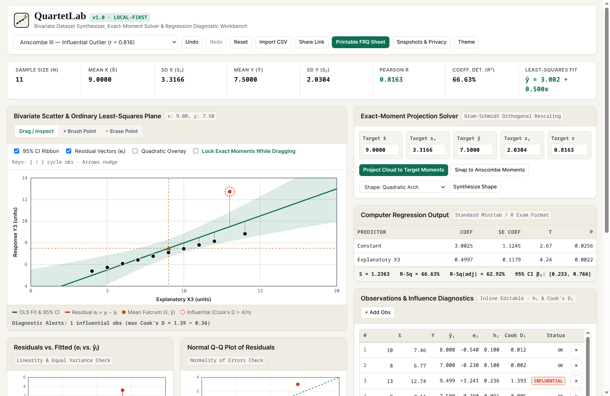
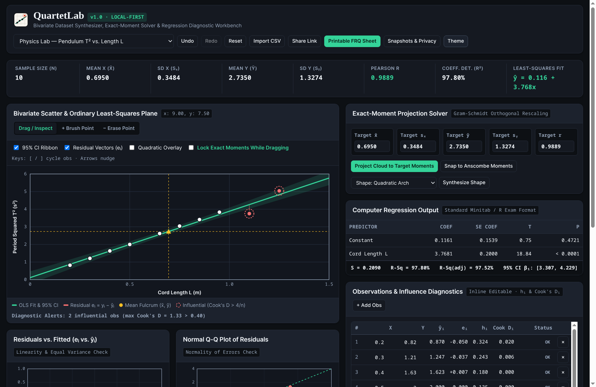
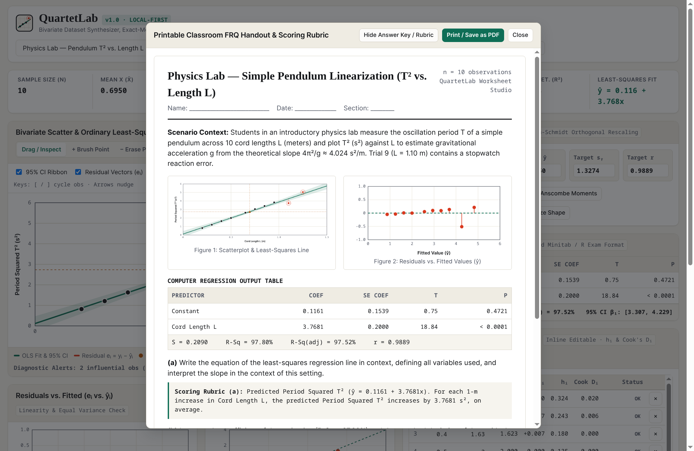

# QuartetLab

[](https://rkohnmn.github.io/datasense-studio/)
[](https://rkohnmn.github.io/datasense-studio/compass/)

[](https://github.com/rkohnmn/quartetlab/actions/workflows/ci.yml)
[](https://github.com/rkohnmn/quartetlab/actions/workflows/deploy.yml)
[](./LICENSE)
[](./package.json)
[](./docs/PRIVACY.md)
[](https://rkohnmn.github.io/quartetlab/)

**Interactive Bivariate Dataset Synthesizer, Exact-Moment Solver & Regression Diagnostic Studio.**

[🚀 **Launch QuartetLab Live**](https://rkohnmn.github.io/quartetlab/) &bull; [📐 Architecture & Solver](docs/ARCHITECTURE.md) &bull; [🔬 Evidence & Literature](docs/RESEARCH.md) &bull; [🔒 Privacy Audit](docs/PRIVACY.md) &bull; [📋 Launch Plan](docs/LAUNCH_PLAN.md)

QuartetLab is a static web app for GitHub Pages. It runs entirely inside your browser. It requires no server setup. Instructors and analysts use it to draw or import bivariate data. You can project point clouds onto exact sample moments ($\bar{x}, s_x, \bar{y}, s_y, r$) in one click. You can inspect ordinary least-squares (OLS) residuals, hat values ($h_i$), and Cook's Distance diagnostics in real time. It updates at 60fps. Calculations happen instantly. When finished, export your work to CSV, R, Python, TI-84 lists, LaTeX tables, or a printable classroom free-response (FRQ) worksheet.



## 1. Product Name and Purpose

**QuartetLab** takes its name from Francis Anscombe's 1973 quartet of four datasets. Its purpose is direct. It connects visual dataset sketching, exact linear-algebraic moment matching, point-level regression diagnostics, and classroom worksheet creation inside one browser tab. It works offline.

## 2. The Problem

Instructors and analysts need paired datasets that meet two strict goals at once:

1. **Exact Numerical Moments**: The data must hit specific sample means $(\bar{x}, \bar{y})$, sample standard deviations $(s_x, s_y)$, Pearson correlation $r$, and OLS slope $\hat{\beta}_1$.
2. **Controlled Diagnostic Shapes**: The cloud must show a parabolic arch, a heteroscedastic fan, an extreme hat-value point ($h_i > 4/n$), or a high-influence outlier (Cook's Distance $D_i > 4/n$).

Freehand drawing tools cannot lock exact summary moments. Classroom regression applets calculate passive summaries on pasted numbers. Neither tool lets an instructor drag a point at 60fps while exporting a Minitab regression table and a TI-84 calculator list.

## 3. Target Audience

- **High School and College Statistics Teachers**: AP Statistics and introductory college instructors who author weekly lab handouts, Minitab output quizzes, and grading rubrics.
- **Physics and STEM Lab Instructors**: Educators who teach curve linearization (such as pendulum period squared $T^2$ against cord length $L$) and experimental error analysis.
- **Data Science Writers and Students**: Analysts who build reproducible examples showing why summary statistics hide model failures.

## 4. Why the Problem Matters

Writing custom R or Python scripts to orthogonalize residuals takes 30 to 45 minutes per quiz. Because that manual workflow is slow, instructors reuse static textbook tables that students find online. QuartetLab turns dataset creation into a two-minute visual task. It saves time. Students gain a sandbox where moving one outlier immediately shifts the OLS line, the residual plot, and the $t$-test $p$-value.

## 5. Market Research and Evidence

Market research conducted on October 26, 2026 identified four clear gaps across current tools (see [`docs/RESEARCH.md`](./docs/RESEARCH.md) for full citations):

- **Sketching tools lack exact moment control**: Robert Grant built [DrawMyData](https://robertgrantstats.co.uk/drawmydata.html) in August 2016 ([Introduction to the New Statistics](https://thenewstatistics.com/itns/2016/08/22/draw-your-own-data-tool/)). Alberto Cairo used it to draw the Datasaurus ([Experimentology](https://experimentology.io/015-viz.html)). Reviews of Python's `drawdata` package ([Python in Plain English, Jan 2025](https://python.plainenglish.io/drawdata-the-python-library-you-didnt-know-you-needed-b8c2f2ff328b)) note that hand-drawn clouds never match exact target distributions without extra code.
- **Classroom applets are read-only calculators**: Teachers on [r/matheducation](https://www.reddit.com/r/matheducation/comments/glclup/teaching_statistics_and_ap_statistics_for_the/) recommend [Stapplet Two Quantitative Variables](https://www.stapplet.net/quant2v.html) and Rossman/Chance applets. Those sites plot pasted data well. But users cannot drag points, lock moments, or inspect Cook's Distance halos.
- **Calculator fluency and Minitab tables drive exam prep**: Veteran AP Statistics teachers on [r/matheducation](https://www.reddit.com/r/matheducation/comments/glclup/teaching_statistics_and_ap_statistics_for_the/) stress that students need daily practice with TI-84 lists and standard computer regression tables (`Coef`, `SE Coef`, `T`, `P`, `S`, `R-Sq`).
- **Built-in applet datasets lack real context**: Educators on [r/matheducation](https://www.reddit.com/r/matheducation/comments/glclup/teaching_statistics_and_ap_statistics_for_the/) and [r/statistics](https://www.reddit.com/r/statistics/comments/rpib1u/q_ap_statistics_hands_on_labs/) report that built-in datasets often give bare column names without units or a story.

## 6. Existing Alternatives and Differentiation

- **QuartetLab**: Supports live point dragging, exact Gram-Schmidt moment projection ($10^{-10}$ tolerance), synchronized Residual and Q-Q plots, hat values $h_i$, Cook's Distance $D_i$, Minitab output tables, TI-84/R/Python/LaTeX exports, printable FRQ handouts, and URL hash sharing.
- **DrawMyData**: Supports freehand point brushing and CSV copy, but lacks moment locking, OLS lines, residual plots, and code exports.
- **Stapplet (`quant2v`)**: Computes scatterplots and regression residuals for pasted data, but lacks interactive synthesis, influence diagnostics, TI-84 list commands, and printable FRQ sheets.
- **Python `drawdata`**: Provides a Jupyter notebook sketchpad for 2D clusters, but requires a local Python environment and lacks exact moment solvers or regression tables.

## 7. Curated Domain Presets

| Preset | Context | Sample Size | Target Moments | Diagnostic Focus |
| :--- | :--- | :---: | :--- | :--- |
| **Anscombe I** | Standard Linear | $n = 11$ | $\bar{x}=9.0, s_x=3.32, \bar{y}=7.50, s_y=2.03, r=0.816$ | Homoscedastic baseline fit |
| **Anscombe II** | Non-Linear Arch | $n = 11$ | $\bar{x}=9.0, s_x=3.32, \bar{y}=7.50, s_y=2.03, r=0.816$ | Curvature ($R^2_{\text{quad}} > 0.999$) |
| **Anscombe III** | Influential Outlier | $n = 11$ | $\bar{x}=9.0, s_x=3.32, \bar{y}=7.50, s_y=2.03, r=0.816$ | Obs 3: Cook's $D_i = 1.32 > 1.0$ |
| **Anscombe IV** | High Hat Outlier | $n = 11$ | $\bar{x}=9.0, s_x=3.32, \bar{y}=7.50, s_y=2.03, r=0.816$ | Obs 8: Hat value $h_i = 1.0$ |
| **Pendulum Lab** | Physics Dynamics | $n = 8$ | $T^2 \propto L$, slope $= 4\pi^2 / g$ | Linearization ($g \approx 9.8\,\text{m/s}^2$) |
| **Heteroscedastic Fan** | Household Economics | $n = 16$ | Income vs. dining spend | Non-constant error variance |
| **Culinary Yield Audit** | Kitchen Operations | $n = 10$ | Butcher trim yield % vs. portion cost | Diminishing margin decay |
| **Pass-Block Win %** | Sports Analytics | $n = 12$ | Pass-block win rate vs. pocket time | High-hat tackle evaluation |

## 8. Core Features

1. **Synchronized Dual-Canvas Workbench**: Drag any point on the scatter plot. Watch the OLS line, 95% confidence ribbon, mean fulcrum $(\bar{x}, \bar{y})$, residual plot ($e_i$ vs. $\hat{y}_i$), and normal Q-Q plot update at 60fps.
2. **Gram-Schmidt Exact-Moment Solver**: Enter target values for $\bar{x}, s_x, \bar{y}, s_y$, and Pearson $r$. QuartetLab orthogonalizes the residuals and rescales the cloud so sample moments match your targets to 10 decimal places. It solves in milliseconds.
3. **Parametric Shape Synthesizer**: Generate a Quadratic Arch, Elliptical Ring, Three Clusters, Megaphone Fan, or High-Hat Outlier with exact target moments in one click.
4. **Multi-Format Code and Calculator Exports**: Export CSV files with diagnostics, reproducible R (`lm`) and Python (`scipy.stats`) scripts, TI-84 Plus `L1/L2` list commands, and LaTeX `booktabs` tables.
5. **Printable Classroom FRQ Studio**: Open a print-ready handout with your scenario text alongside scatter and residual figures, a Minitab regression table, three free-response prompts, and a toggleable scoring key.

## 9. Mathematical Formulation

### Ordinary Least-Squares Fit

For paired observations $(x_1, y_1), \dots, (x_n, y_n)$:

$$\hat{\beta}_1 = \frac{\sum_{i=1}^n (x_i - \bar{x})(y_i - \bar{y})}{\sum_{i=1}^n (x_i - \bar{x})^2} = r \frac{s_y}{s_x}, \qquad \hat{\beta}_0 = \bar{y} - \hat{\beta}_1 \bar{x}$$

$$s_e = \sqrt{\frac{\sum_{i=1}^n e_i^2}{n - 2}}, \qquad SE_{\hat{\beta}_1} = \frac{s_e}{\sqrt{\sum_{i=1}^n (x_i - \bar{x})^2}}$$

### Influence Diagnostics

- **Hat Matrix Diagonal ($h_i$)**:
  $$h_i = \frac{1}{n} + \frac{(x_i - \bar{x})^2}{\sum_{j=1}^n (x_j - \bar{x})^2}$$
  Points with $h_i > 4/n$ display an amber warning flag.

- **Cook's Distance ($D_i$)**:
  $$D_i = \frac{r_i^2}{2} \cdot \frac{h_i}{1 - h_i}$$
  Points with $D_i > 4/n$ display a vermilion indicator ring.

## 10. Visual Demonstrations

### Precision Dark Instrument Theme



### Printable Classroom FRQ Handout View



## 11. Technology Stack

- **Markup**: Semantic HTML5 (`index.html`) with ARIA live regions, modal dialogs, and keyboard shortcuts.
- **Styling**: Modular CSS custom properties (`css/tokens.css`, `css/base.css`, `css/components.css`, `css/print.css`) defined in [`DESIGN.md`](./DESIGN.md).
- **Computation**: Vanilla ES2022 modules (`js/math-engine.js`, `js/renderer.js`, `js/exporters.js`, `js/presets.js`, `js/storage.js`, `js/app.js`) using the HTML5 2D Canvas API.
- **Verification**: Node.js built-in test runner (`node --test`) and Python static checks (`tests/verify-build.py`).

Read [`docs/ARCHITECTURE.md`](./docs/ARCHITECTURE.md) for the linear algebra behind the Gram-Schmidt solver and Student-$t$ incomplete-beta $p$-value evaluator.

## 12. Design Decisions

- **Bell Labs Monograph Aesthetic**: Following [`DESIGN.md`](./DESIGN.md), the workspace uses warm archival paper (`#F6F4EE`) and charcoal ink (`#141619`). Phosphor emerald (`#0F6E56`) marks the OLS fit, while vermilion (`#D9381E`) flags high Cook's Distance points.
- **Tabular Numerals**: Each numeric readout, coordinate input, and table cell applies `font-variant-numeric: tabular-nums`. Numbers never jump horizontally during live dragging.
- **Locked Axis Bounds on Drag**: Grabbing a point locks the plot bounds until pointer release so the coordinate frame stays steady under the cursor.

## 13. Privacy and Data Handling

QuartetLab runs 100% locally in your browser tab. It makes zero network calls after page load. It includes zero analytics scripts and never uploads CSV data to any server. Active work and saved snapshots stay in `window.localStorage`. Open **Snapshots & Privacy** in the top bar to inspect or wipe stored bytes at any time. See [`docs/PRIVACY.md`](./docs/PRIVACY.md) for details.

## 14. Keyboard Controls

| Shortcut | Scope | Behavior |
| :--- | :--- | :--- |
| `[` | Points Table | Select previous observation in list |
| `]` | Points Table | Select next observation in list |
| `Arrow Keys` | Active Point | Nudge coordinates by 0.1 units |
| `Shift + Arrows` | Active Point | Nudge coordinates by 1.0 units |
| `Ctrl+Z` / `Cmd+Z` | Workbench | Undo last edit or brush action |
| `Ctrl+Y` / `Cmd+Shift+Z` | Workbench | Redo undone action |

## 15. Local Development

You need Python 3.8+ (or any static file server) and Node.js 18+ (for running tests).

```bash
git clone https://github.com/rkohnmn/quartetlab.git
cd quartetlab
npm run serve
```

Open `http://localhost:8080` in your browser. The project requires no build step or package installation.

## 16. Testing Instructions

Run the test suite and build verifier from the root folder:

```bash
npm test
npm run verify
npm run lint:docs
```

All 12 unit test suites, subpath checks, and prose audits run in under three seconds.

## 17. GitHub Pages Deployment

QuartetLab ships with an automated GitHub Actions workflow in [`.github/workflows/deploy.yml`](./.github/workflows/deploy.yml).

1. Push the repository to GitHub on the `main` branch.
2. Open your repository settings and select **Pages**.
3. Under **Build and deployment -> Source**, choose **GitHub Actions**.
4. The workflow runs `npm test` and `npm run verify`, packages the static files, and publishes your site.

You can also deploy directly from the `main` branch root because `.nojekyll` and `index.html` sit at the top level.

## 18. Repository Subpath and Asset Safety

All local asset links use relative paths (`./css/...`, `./js/...`, `./assets/...`). Shared links store data in the client URL hash (`#state=...`). QuartetLab works without modification at a root domain (`https://example.com/`) or under a repository subpath (`https://rkohnmn.github.io/quartetlab/`).

## 19. Known Limitations

- **Sample Size Range**: The interactive canvas and moment solver target classroom and lab datasets from $n = 3$ to $n = 200$ points. Larger datasets belong in R or Python.
- **Bivariate Focus**: QuartetLab models two quantitative variables ($X$ and $Y$) plus quadratic overlays, not multiple matrix regression.
- **Browser Support**: Compatible with Chrome/Edge 110+, Firefox 115+, and Safari 16.4+ across desktop and mobile screens (`390px` to `1440px+`).

## 20. Roadmap

- **v1.1**: Add permutation test and bootstrap slope confidence interval animations.
- **v1.2**: Add categorical group colors (2 to 3 groups) to synthesize Simpson's Paradox datasets.
- **v1.3**: Add direct LaTeX `.tex` full-handout file downloads alongside browser printing.

## 21. Contribution Instructions

Read [`CONTRIBUTING.md`](./CONTRIBUTING.md) before opening a pull request. New code must pass `npm test`, `npm run verify`, and `npm run lint:docs`.

## 22. License

QuartetLab carries the permissive [MIT License](./LICENSE).


## Product quality and browser checks

See [PRODUCT_AUDIT.md](PRODUCT_AUDIT.md) for the responsive-interface changes, import contracts and limits, regression coverage, and remaining work. After installing the development requirements and Chromium, run `npm run test:browser` for actual browser validation.
